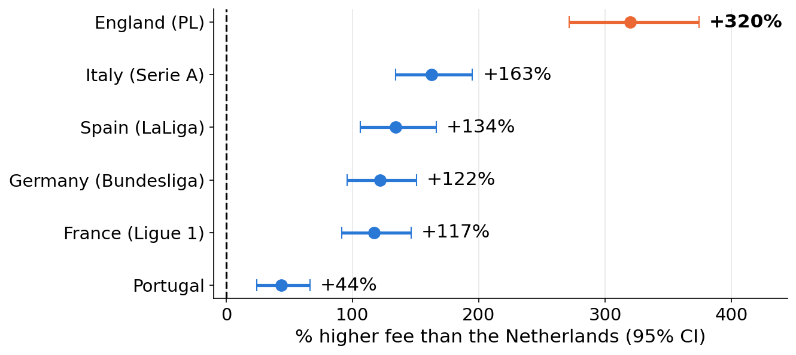
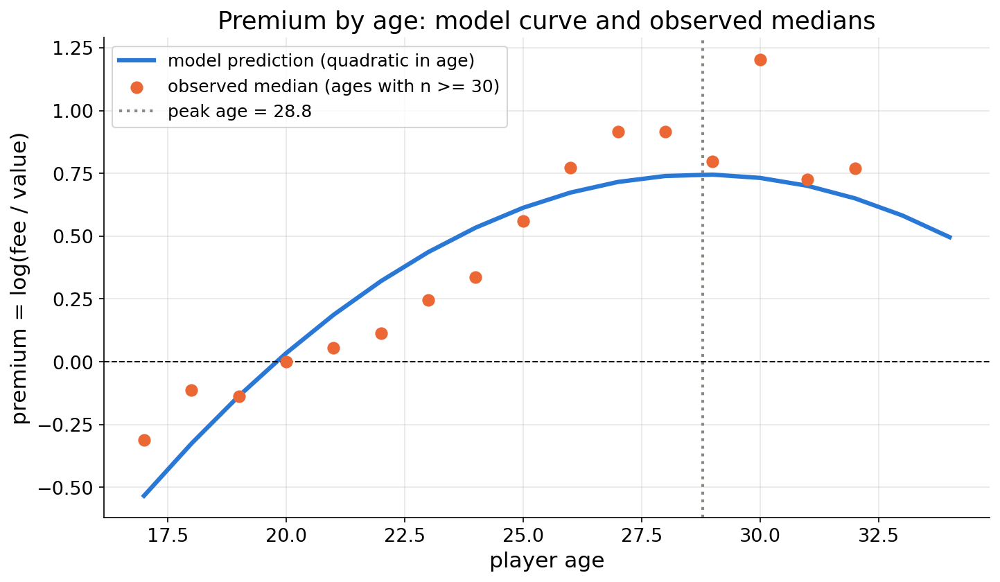
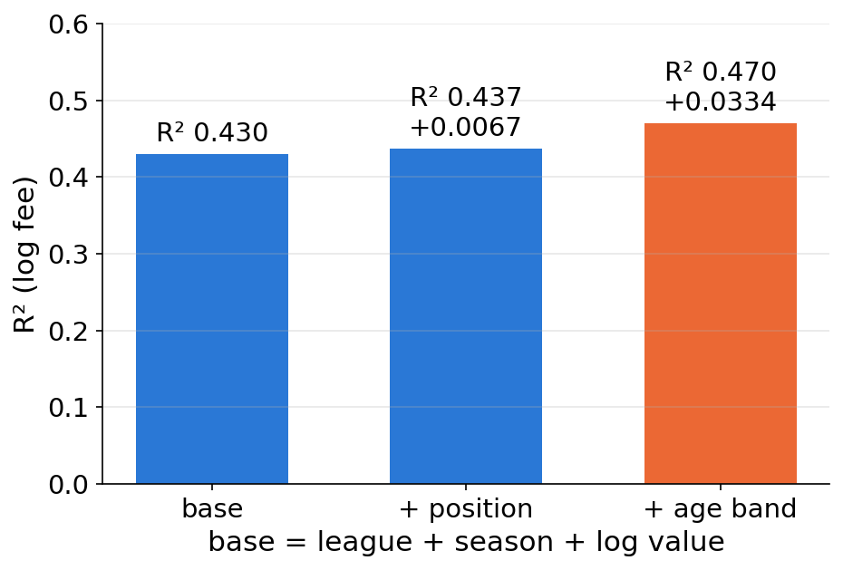
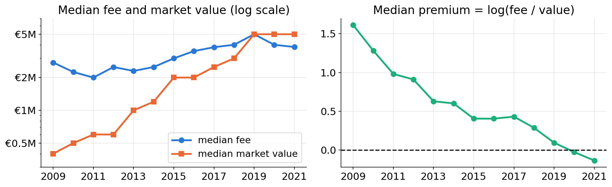
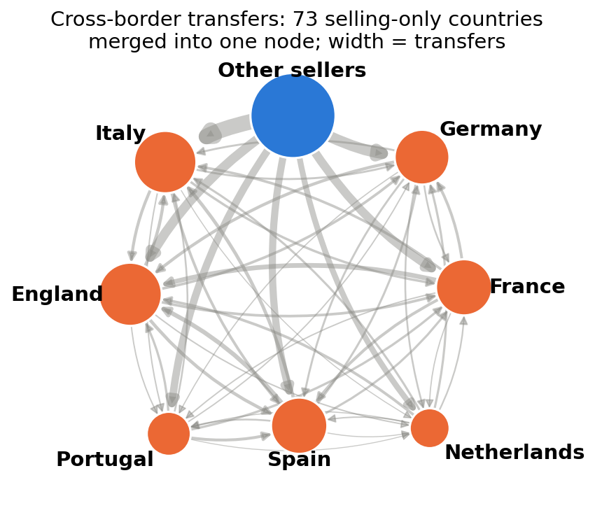

# The League Tax

Do some buying leagues systematically overpay for football players? A statistical analysis of 6,063 paid transfers into Europe's seven biggest leagues (2009–2021), comparing each fee with the player's Transfermarkt market value.



*Estimated % difference in the fee compared with the Netherlands, holding market value, position, age band, season and domestic/foreign deal fixed (95% CIs).*

## Key findings

- **England pays the most for a comparable player:** +320% [+272, +375] compared with the Netherlands. It is the top-paying league in **13 of 13** subgroups (age, position, deal size, period).
- **Absolute overpay:** for a standard player (€2.0M midfielder, age 22–25, 2021, bought from abroad) the predicted fee/value ratio is **2.44** in England, against **0.83** in Portugal and **0.58** in the Netherlands.
- **Age matters about five times more than position:** adding age raises R² by 0.0334, adding position by 0.0067. The premium peaks at **28.8 years**.
- **Premiums shrink with deal size and over time:** the median premium fell from 1.609 (2009) to −0.134 (2021) because market values rose faster than fees.

## The question

**Main question:** do some buying leagues systematically overpay for players?

The premium of a transfer is `log(fee) − log(market value)`. A premium above 0 means the fee was above the market value.

- **Relative overpay:** a league pays a higher fee than other leagues for a *comparable* player (same market value, age, position, season, domestic/foreign deal).
- **Absolute overpay:** the predicted fee / market-value ratio for a *standard player* bought by that league is above 1.
- **Systematic:** the league gap appears in every age band, position group, value quartile and period, not only in one subgroup.

**Subquestions**

1. **Age:** does the premium depend on age, and what shape does the relation have?
2. **Position:** does it differ by position once age is held fixed?
3. **Deal size:** do cheap and expensive players carry different premiums?
4. **Time:** did premiums and league gaps change between 2009 and 2021, in particular after 2016?
5. **Origin:** does buying from abroad cost more, and what does the country transfer network look like?

## Data

- **Source:** [d2ski/football-transfers-data](https://github.com/d2ski/football-transfers-data), scraped from Transfermarkt. Not redistributed here; see [data/README.md](data/README.md) for how to download it.
- **Period:** seasons 2009–2021.
- **Buying leagues:** Premier League (England), LaLiga (Spain), Serie A (Italy), Bundesliga (Germany), Ligue 1 (France), Liga Portugal, Eredivisie (Netherlands).

**Cleaning funnel** ([tables/cleaning_funnel.csv](tables/cleaning_funnel.csv))

| Step | Rows |
|---|---:|
| Raw file | 70,006 |
| Buying side only (`dir == "in"`) | 31,934 |
| Permanent moves (no loan, no loan end) | 17,983 |
| Fee > 0 | 7,217 |
| Market value > 0 | 6,097 |
| Age 15–45 | 6,097 |
| Outlier rule \|z(premium)\| ≤ 3 | **6,063** |

**Outlier rule:** the premium is standardised to a z-score, and transfers with |z| > 3 are dropped (34 deals, 19 of them Italian). Nine of the 10 largest dropped fees are €500–550M Serie A fees (2009–2013) for players valued between €25k and €500k, i.e. corrupted records.

## Method

Only methods from the course toolkit:

- log transforms, z-scores, binning, dummy encoding, feature engineering
- Pearson / Spearman correlation
- two-sample t-test, chi-square test of independence
- one-way ANOVA with Tukey HSD
- simple and multiple linear regression (OLS) with R² and predictions
- network science (degree, strength, betweenness and eigenvector centrality, reciprocity, assortativity, fast-greedy communities)

**Main model** (OLS, n = 6,063, R² = 0.475):

```
log_fee ~ C(league, ref = Netherlands) + log_val + C(position, ref = ATT)
          + C(age_band, ref = <=21) + C(season) + is_domestic
```

Because the outcome is in logs, a dummy coefficient *b* means the fee is (exp(b) − 1) × 100% higher than for the reference group. The coefficient on `log_val` is the fee's elasticity with respect to market value (0.523).

**One extension beyond the course:** HC3 heteroskedasticity-robust standard errors, reported next to the normal ones because the residual spread falls with the fitted value. They change no conclusion.

"Systematic" is tested by refitting the model inside 13 subgroups (3 age groups, 4 positions, 4 value quartiles, 2 periods), with Germany as the reference league.

## Results

### Age



Mean premiums differ strongly across age bands (ANOVA F = 154.18, p = 2.7 × 10⁻⁹⁶). Compared with players aged 21 or younger, the model gives +54.8% for 22–25, +115.2% for 26–29 and +83.8% for 30+. A quadratic age term puts the peak at **28.8 years**. England pays more than Germany in all three age groups. The Netherlands and Portugal pay less in all three.

### Position



Raw premiums differ little by position (ANOVA F = 7.02). Goalkeepers have the second-highest raw median premium, but once age is held fixed they become the cheapest group (−35.0% [−42.0, −27.3] vs. attackers), because 42.4% of them are 26 or older. Adding position to a base model raises R² by 0.0067. Adding age after position raises it by 0.0334.

### Deal size

The fee grows less than one-for-one with market value (elasticity 0.523), so cheaper players carry larger premiums. For the standard player, the predicted ratio averaged over leagues is 3.28 at the median value of the cheapest quartile (€0.3M) and 0.49 in the most expensive quartile (€16M). England pays more than Germany in all four value quartiles. Part of this gradient may be mechanical, since the market value is both the denominator of the premium and the basis of the quartiles.

### Time



From 2009 to 2021 the median market value rose from €0.4M to €5.0M, while the median fee went from €2.75M to €3.82M. The median premium fell from 1.609 to −0.134 (Spearman ρ = −0.290 with season). England's lead over Germany is positive both before and after 2016 (+120% and +62%). An England × post-2016 interaction is not significant (+9.1% [−4.6, +24.8], p = 0.204), so the data give no evidence that the Premier League gap grew after the 2016 TV deal.

### Origin and the transfer network



Holding the player fixed, a domestic purchase costs 18.7% less [−22.9, −14.3], i.e. buying abroad costs about 23.0% more. The abroad premium is significant in six leagues but absent in Italy (−2%, p = 0.71). The cross-border network has 80 countries and 3,292 transfers. All 21 pairs of buying countries trade in both directions, and community detection finds only weak structure (2 communities, modularity Q = 0.079). England is the largest net spender on cross-border deals (+€6,781M).

## Limitations

- **Not causal.** The models describe associations between the buying league and the fee, holding observed variables fixed. Unobserved player quality, wages, agent fees and bargaining position are not in the data.
- **Disclosure bias.** Only transfers with a published fee enter the sample. The share of permanent incoming transfers that reach the sample ranges from 49.0% (England) to 13.6% (Portugal), and inclusion depends on the league (χ² = 1,370.7, df = 6, p ≈ 10⁻²⁹³). Dropped deals involve cheaper players in every league.
- **Market value is an estimate.** Transfermarkt values are crowd-sourced estimates, not prices. If they are marked down faster for older players, or are noisy for cheap players, part of the age and deal-size effects reflects how the value is built, not club behaviour.
- **Repeated players and clubs.** The 6,063 transfers involve 4,179 distinct players and 219 buying clubs, so observations are not fully independent and standard errors may be somewhat too small.
- **One-sided network.** The dataset records only purchases by clubs in the 7 leagues, so other countries appear only as sellers.

## Repository structure

```
league-tax/
├── README.md
├── LICENSE                 MIT, covers the code
├── requirements.txt
├── notebooks/
│   └── transfer_premium_analysis.ipynb   full analysis, with outputs
├── data/
│   └── README.md           source and download instructions (CSV not included)
├── figures/                26 PNGs written by the notebook (slide_* = sized for slides)
├── tables/                 34 CSVs written by the notebook; key_results.csv has the headline numbers
└── presentation/
    ├── league_tax_presentation.pptx
    └── league_tax_presentation.pdf
```

## How to reproduce

Tested with Python 3.9.18.

```bash
git clone [REPO URL]
cd league-tax
python3 -m venv venv
source venv/bin/activate
pip install -r requirements.txt

# get the data (see data/README.md)
curl -L -o data/transfers.csv \
  https://raw.githubusercontent.com/d2ski/football-transfers-data/main/dataset/transfers.csv

# run the notebook from notebooks/ (about 20 seconds); figures/ and tables/ are rewritten
cd notebooks
jupyter nbconvert --to notebook --execute --inplace transfer_premium_analysis.ipynb
```

To work interactively, open the notebook in VS Code or install JupyterLab (`pip install jupyterlab`). The random seed is fixed (42), so the numbers match `tables/key_results.csv`.

## Academic context

Exam project for **Data Management and Analysis** (Prof. Walter Quattrociocchi), Sapienza University of Rome, [academic year].

**AI use:** [I will fill this in]

## License

The code in this repository is released under the [MIT License](LICENSE). The dataset is not included and is not covered by this license. It belongs to its original sources (Transfermarkt, via d2ski/football-transfers-data).

## Author

[my name] · [LinkedIn](https://www.linkedin.com/in/[your-handle]) · [GitHub](https://github.com/[your-username]) · [Portfolio]([your-website])
